<div align="center">

# Find the Law

### Recovering physical laws from raw measurements, then testing them on unseen data

**Stopping distance** &nbsp;·&nbsp; **Vapour pressure**


*Final Group Project · Problem 2 · Instructor: Dr. Ayana Ghosh*

</div>

---

## Contents

1. [The question](#the-question)
2. [Team and who-did-what](#team-and-who-did-what)
3. [Repository layout](#repository-layout)
4. [Quick start](#quick-start)
5. [Data: where it came from](#data-where-it-came-from)
6. [Part 1: Physics model, simulate and verify](#part-1-physics-model-simulate-and-verify)
7. [Part 2: Data and statistics](#part-2-data-and-statistics)
8. [Data testing](#data-testing)
9. [Supplementary analysis](#supplementary-analysis)
10. [Rubric map](#rubric-map)
11. [Scope and limitations](#scope-and-limitations)

---

## The question

> *Given raw measurements, can we recover the physical law behind them and test it on data it has not seen?*

We study two systems, each with a closed-form law and a differential equation behind it.

| | Stopping distance | Vapour pressure |
|---|---|---|
| **Law** | $d = v\,t_r + \dfrac{v^2}{2\mu g}$ | $P = P_0\exp\!\left[-\dfrac{L}{R}\left(\dfrac1T-\dfrac1{T_0}\right)\right]$ |
| **ODE** | $\dfrac{dx}{dt}=v,\ \ \dfrac{dv}{dt}=-\mu g$ | $\dfrac{dP}{dT}=\dfrac{L\,P}{R\,T^2}$ |
| **Unknowns fitted** | reaction time $t_r$, friction $\mu$ | latent heat $L$ (and $P_0$) |
| **Parameters used** | $t_r=0.7$ s, $\mu=0.7$, $g=9.81$ m/s² | $R=8.314462618$ J/(mol·K), $T$ in kelvin, constant $L$ |
| **Effect the model omits** | road-grade factor (1.000 → 1.020) | temperature dependence of $L$ |

---

### Workflow overview

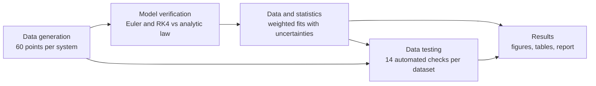

---

## Team and who-did-what

Each stage was owned by one team member.

| # | Member | Roll no. | Stage | Where to look |
|:-:|---|---|---|---|
| 1 | Priyangshu Goswami | EP26B022 | Data collection / generation | [`data/`](data) |
| 2 | G K Dhakshini | PH26B004 | Model simulation and verification 1 (stopping distance) | [`notebooks/02_…`](notebooks/02_stopping_distance_model_verification.ipynb), [`src/braking.py`](src/braking.py) |
| 3 | Kabil Arasan | EP26B013 | Model simulation and verification 2 (vapour pressure) | [`notebooks/03_…`](notebooks/03_vapour_pressure_model_verification.ipynb), [`src/clausius_clapeyron.py`](src/clausius_clapeyron.py) |
| 4 | Mutturaj Shirahatti | EP26B018 | Data and statistics 1 (stopping distance) | [`notebooks/04_…`](notebooks/04_stopping_distance_data_statistics.ipynb) |
| 5 | Vetcha Venkata Sai Lokesh | EP26B041 | Data and statistics 2 (vapour pressure) | [`notebooks/05_…`](notebooks/05_vapour_pressure_data_statistics.ipynb), [`src/vapour_pressure_data_statistics.py`](src/vapour_pressure_data_statistics.py) |
| 6 | V. Monish Reddy | MM25B050 | Data testing 1 (stopping distance) | [`notebooks/06_…`](notebooks/06_stopping_distance_data_testing.ipynb), [`tests/`](tests/test_stopping_distance_data.py) |
| 7 | Mahith Chintala | MM23B004 | Data testing 2 (vapour pressure) | [`notebooks/07_…`](notebooks/07_vapour_pressure_data_testing.ipynb), [`tests/`](tests/test_vapour_pressure_data.py) |

---

## Repository layout

```text
PH1050_End_Term_Project/
├── README.md                      ← you are here
├── requirements.txt               ← Python dependencies
├── pytest.ini
├── data/
│   ├── stopping_distance_60_values.csv      60 points, 20–120 km/h
│   └── vapour_pressure_60_values.csv        60 points, 20–100 °C
├── notebooks/                     ← the team's original notebooks (Colab-style)
│   ├── 02_stopping_distance_model_verification.ipynb
│   ├── 03_vapour_pressure_model_verification.ipynb
│   ├── 04_stopping_distance_data_statistics.ipynb
│   ├── 05_vapour_pressure_data_statistics.ipynb
│   ├── 06_stopping_distance_data_testing.ipynb
│   └── 07_vapour_pressure_data_testing.ipynb
├── src/                           ← reusable code and scripts
│   ├── braking.py                           Euler / RK4 braking ODE
│   ├── clausius_clapeyron.py                Euler / RK4 Clausius–Clapeyron ODE
│   ├── braking_verification.py              regenerates stopping verification results
│   ├── vapour_pressure_data_statistics.py   weighted fit + PDF report (stage 5)
│   └── supplementary_analysis.py            noise, correlation, residual and extrapolation analysis
├── tests/                         ← 42 pytest tests
├── results/
│   ├── figures/                   all plots used below
│   ├── tables/                    convergence and rms tables (CSV)
│   └── reports/                   vapour pressure statistics report (PDF)
└── docs/
    └── presentation_find_the_law.pptx       the group presentation
```

> Notebook numbers follow the order of work; stage 1 is the data in `data/`.

---

## Quick start

```bash
git clone https://github.com/Mahith2203/PH1050_End_Term_Project.git
cd PH1050_End_Term_Project
python -m venv .venv && source .venv/bin/activate     # Windows: .venv\Scripts\activate
pip install -r requirements.txt

pytest                                                # run all 42 tests
python src/braking_verification.py                    # stopping-distance verification results
python src/vapour_pressure_data_statistics.py         # vapour-pressure fit, plots and PDF report
python src/supplementary_analysis.py                  # supplementary figures and summary table
```

The notebooks load their CSV by bare file name. Run them from the `data/` folder, or upload the CSV when prompted in Google Colab.

---

## Data: where it came from

Both datasets are **generated**, not measured. They are frozen as CSV files in [`data/`](data), and every analysis in this repository reads exactly those files. The generation script itself is not part of the repository.

| | Stopping distance | Vapour pressure |
|---|---|---|
| File | `stopping_distance_60_values.csv` | `vapour_pressure_60_values.csv` |
| Points | 60, equally spaced | 60, equally spaced |
| Range | 20–120 km/h (5.56–33.33 m/s) | 20–100 °C (293.15–373.15 K) |
| Truth | $d=v\,t_r+v^2/(2\mu g)$ with $t_r=\mu=0.7$ | water-like reference curve, 101.34 kPa at 100 °C |
| Effect not in the model | road-grade factor rising 1.000 → 1.020 | latent heat that varies with temperature |
| Noise (rms vs grade-adjusted truth) | about 5.9 % | about 3.4 % |
| Uncertainty column | 5 % of simulated distance | 3 % of simulated pressure |
| Split | 36 train (slowest) / 24 test (fastest) | 36 train (coldest) / 24 test (hottest) |

The problem statement suggests 5 % noise for vapour pressure; the delivered dataset has about 3 %, and the uncertainty column and tests use 3 %.

<details>
<summary><b>Sample rows</b></summary>

**Stopping distance**

| Obs | Speed (km/h) | Theoretical (m) | Simulated (m) | ± Unc. (m) | Split |
|--:|--:|--:|--:|--:|:-:|
| 1 | 20.00 | 6.14 | 6.90 | 0.345 | train |
| 2 | 21.69 | 6.86 | 7.03 | 0.352 | train |
| 3 | 23.39 | 7.62 | 7.35 | 0.367 | train |
| 37 | 81.02 | 52.63 | 51.30 | 2.565 | test |
| 38 | 82.71 | 54.52 | 52.66 | 2.633 | test |
| 39 | 84.41 | 56.44 | 53.29 | 2.665 | test |

**Vapour pressure**

| Obs | T (°C) | Reference (kPa) | Simulated (kPa) | ± Unc. (kPa) | Split |
|--:|--:|--:|--:|--:|:-:|
| 1 | 20.00 | 2.330 | 2.352 | 0.071 | train |
| 2 | 21.36 | 2.533 | 2.676 | 0.080 | train |
| 3 | 22.71 | 2.752 | 2.763 | 0.083 | train |
| 37 | 68.81 | 29.525 | 29.981 | 0.899 | test |
| 38 | 70.17 | 31.316 | 31.696 | 0.951 | test |
| 39 | 71.53 | 33.198 | 34.498 | 1.035 | test |

</details>

<p align="center">
  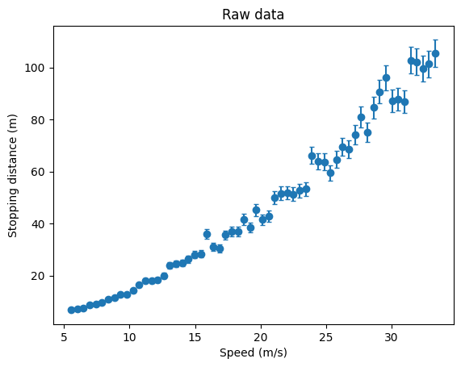
  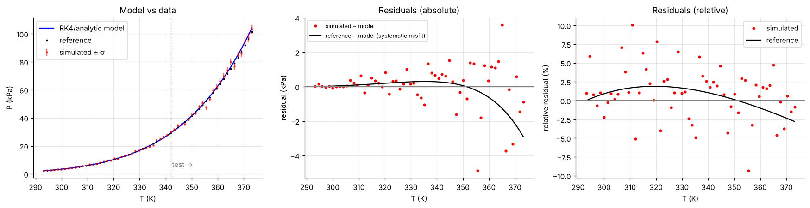
</p>

---

## Part 1: Physics model, simulate and verify

### Braking ODE (Euler and RK4)

After the reaction time the car decelerates at $a=\mu g$. With $y=[x,v]$ the system is $\dot y=[v,\,-\mu g]$. Both solvers shorten the last step so the car stops exactly. Example: $v_0=20$ m/s, $\mu=0.7$, $t_r=0.7$ s, $\Delta t=0.01$ s, $m=1200$ kg.

| Quantity | Analytic | Euler | RK4 |
|---|--:|--:|--:|
| Braking distance (m) | 29.1248 | 29.2247 (+0.34 %) | 29.1248 |
| Total stopping distance (m) | 43.1248 | 43.2247 | 43.1248 |
| Max energy drift of $\tfrac12 mv^2+\mu m g\,x$ | n/a | 0.34 % | ~$10^{-15}$ |
| Measured convergence order | n/a | **1.00** | exact to round-off (~$10^{-12}$ m) |

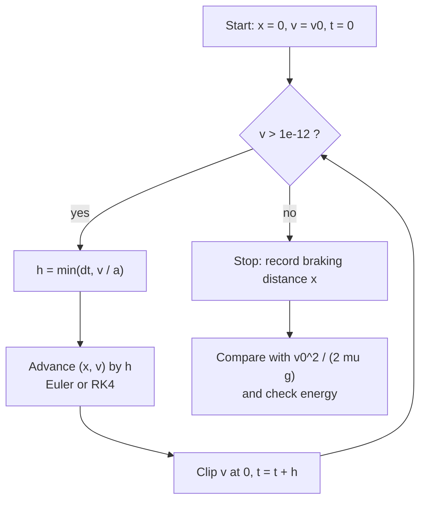

RK4 is exact here because the deceleration is constant, so the solution is a quadratic that RK4 integrates without truncation error.

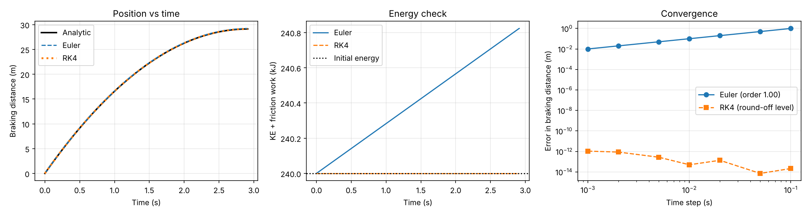

*Left: position against time. Middle: the energy check $\tfrac12 mv^2=\mu m g\,d_\text{brake}$. Right: log-log convergence.* Regenerate with `python src/braking_verification.py`; the table is in [`results/tables/stopping_convergence_table.csv`](results/tables/stopping_convergence_table.csv).

### Clausius–Clapeyron ODE (Euler and RK4)

$$\frac{dP}{dT}=\frac{L\,P}{R\,T^2}\quad\Longrightarrow\quad P=P_0\exp\!\left[-\frac{L}{R}\left(\frac1T-\frac1{T_0}\right)\right]$$

with $T_0=293.15$ K and $L=43.21$ kJ/mol calibrated on the reference column.

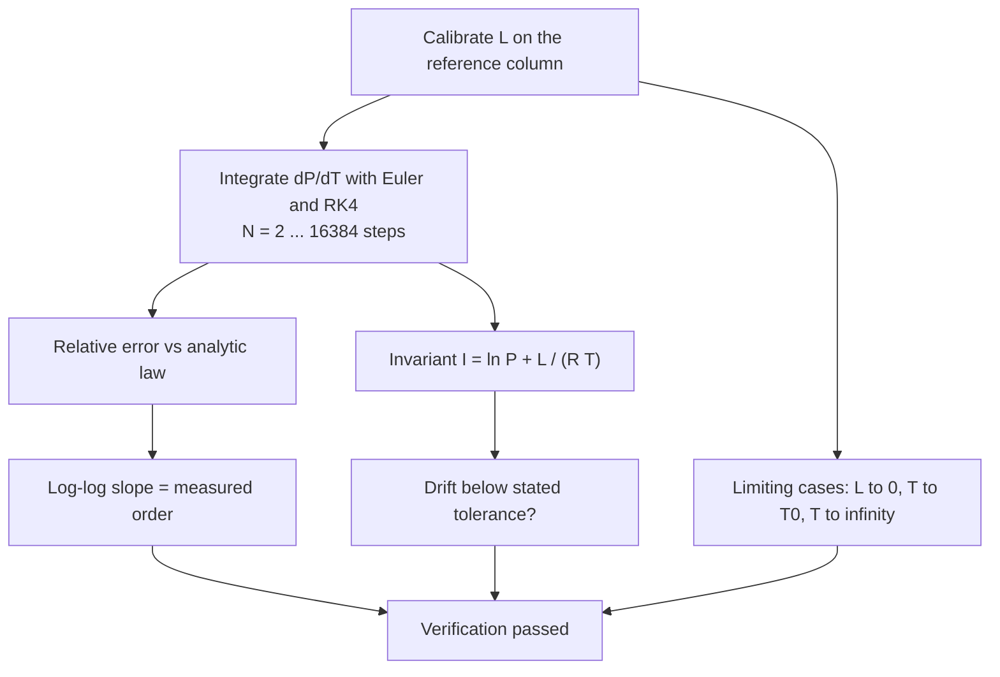

| Check | Result |
|---|---|
| Euler max relative error ($N=40$, $h=2$ K) | 14.1 % |
| RK4 max relative error ($N=40$) | $2.9\times10^{-6}$ |
| SciPy DOP853 cross-check | $1.6\times10^{-10}$ |
| $P(100\,°\text{C})$: analytic / RK4 / Euler | 104.23 / 104.23 / 89.56 kPa |
| Measured convergence order | **0.97** (Euler, theory 1) · **3.96** (RK4, theory 4) |
| Invariant $I=\ln P+\tfrac{L}{RT}$ drift at $N=1000$ | Euler $6.4\times10^{-3}$ (tol. $10^{-2}$) · RK4 $7.9\times10^{-12}$ (tol. $10^{-10}$) |
| Limit $L\to0$ | $P=P_0$ exactly |
| Limit $T\to T_0$ | linear law, error $\propto\Delta T^2$ (ratio ≈ 3.96) |
| Limit $T\to\infty$ | $P\to P_0e^{L/RT_0}$, matched to $10^{-5}$ |

<p align="center">
  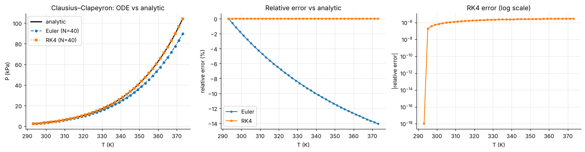
</p>
<p align="center">
  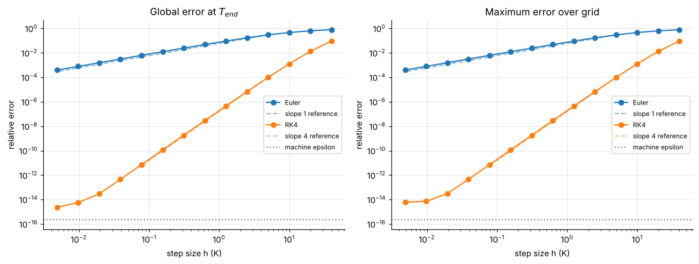
  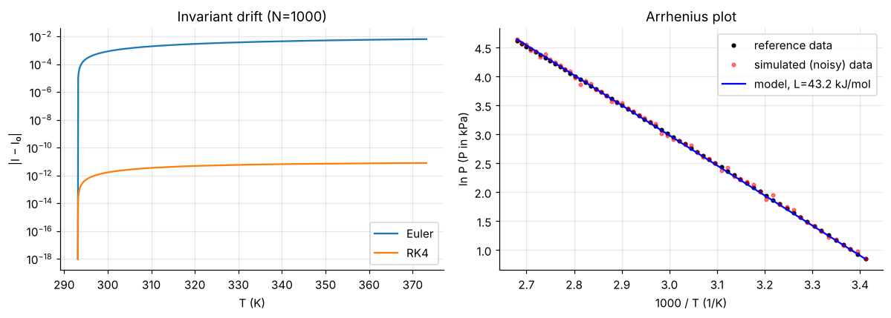
</p>

**Model against the dataset.** With calibrated $L=43.21$ kJ/mol the constant-$L$ law has an rms relative error of 1.43 % against the reference column; the literature value $L(100\,°\text{C})=40.66$ kJ/mol gives 12.78 %. The residual against the reference is smooth and systematic, so it is model-structure error (temperature-dependent $L$), not numerical error. Full table: [`results/tables/vapour_pressure_model_vs_data_rms.csv`](results/tables/vapour_pressure_model_vs_data_rms.csv).

<p align="center">
  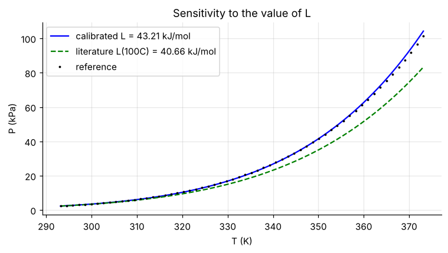
</p>

---

## Part 2: Data and statistics

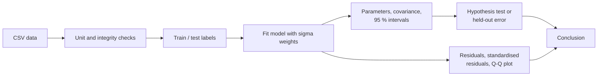

### Stopping distance: fit $t_r$ and $\mu$

Weighted nonlinear least squares (`scipy.optimize.curve_fit`, absolute uncertainties) on all 60 points, 58 degrees of freedom. Notebook: [`04_…`](notebooks/04_stopping_distance_data_statistics.ipynb).

| Parameter | Estimate | 95 % interval |
|---|--:|--:|
| Reaction time $t_r$ | 0.689 ± 0.026 s | [0.636, 0.741] |
| Friction $\mu$ | 0.682 ± 0.015 | [0.653, 0.712] |
| rms error of the fit | 3.09 m | n/a |

**Is the reaction time 0.7 s?** $t=\dfrac{t_r-0.7}{\sigma_{t_r}}=-0.43$, $p=0.669$. We cannot reject $H_0$: the fitted reaction time is consistent with 0.7 s, and 0.7 lies inside the interval.

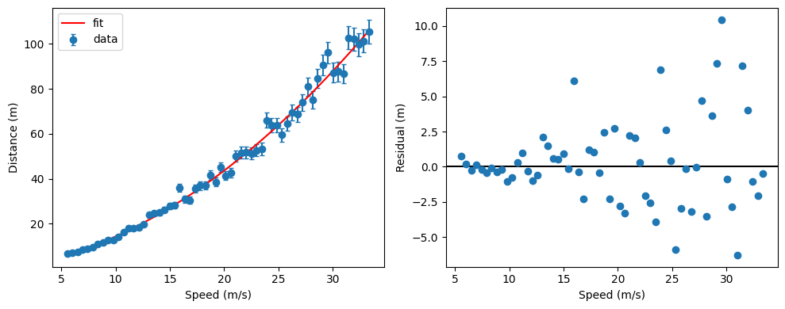

Residuals scatter around zero with no obvious curve and widen with speed, as expected for noise that grows with the distance (the uncertainty column is 5 % of it).

### Vapour pressure: fit $L$

Linearised model $\ln P=\ln P_0-\dfrac{L}{R}\left(\dfrac1T-\dfrac1{T_0}\right)$, weighted straight-line fit with $\sigma_{\ln P}=\sigma_P/P$ and weights $1/\sigma_{\ln P}^2$, **training rows only**. Notebook: [`05_…`](notebooks/05_vapour_pressure_data_statistics.ipynb); script: [`src/vapour_pressure_data_statistics.py`](src/vapour_pressure_data_statistics.py); full report: [`results/reports/vapour_pressure_data_statistics_report.pdf`](results/reports/vapour_pressure_data_statistics_report.pdf).

| Parameter | Estimate | Uncertainty |
|---|--:|--:|
| Latent heat $L$ | **43.128 kJ/mol** | ± 0.295 kJ/mol (95 %: 42.549–43.706) |
| Pressure $P_0$ at 293.15 K | 2.3726 kPa | ± 0.0241 kPa |
| Reduced $\chi^2$ | 1.370 | 34 degrees of freedom |

| Subset | N | RMSE (kPa) | RMS relative error | Mean abs. relative error |
|---|--:|--:|--:|--:|
| Training | 36 | 0.442 | 3.408 % | 2.649 % |
| **Test (held out)** | 24 | 2.106 | **3.593 %** | 2.505 % |
| All data | 60 | 1.376 | 3.483 % | 2.591 % |

The test error is close to the training error. The reduced $\chi^2$ above 1 says the scatter is larger than the stated log-pressure uncertainties alone predict. The fitted $L/R=5187$ K corresponds to an $L$ between water's literature values of about 44.2 kJ/mol at 20 °C and 40.7 kJ/mol at 100 °C, as expected for a temperature-averaged constant $L$.

<p align="center">
  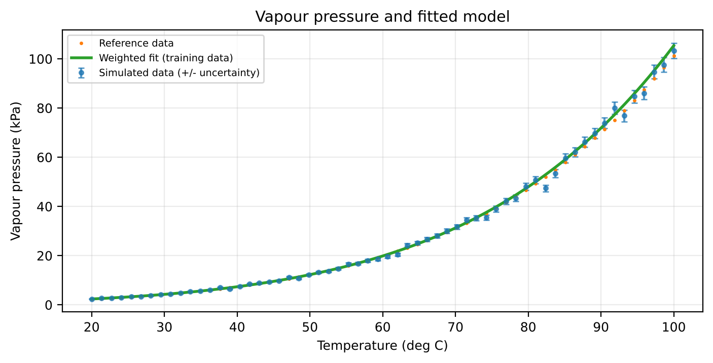
  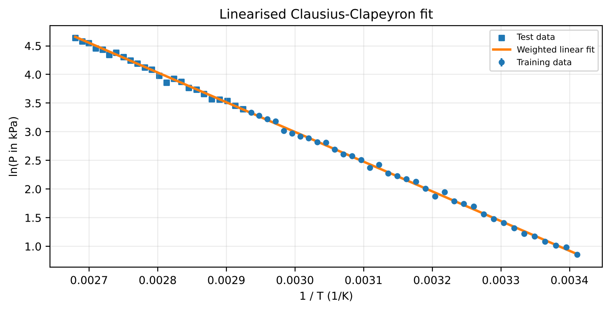
  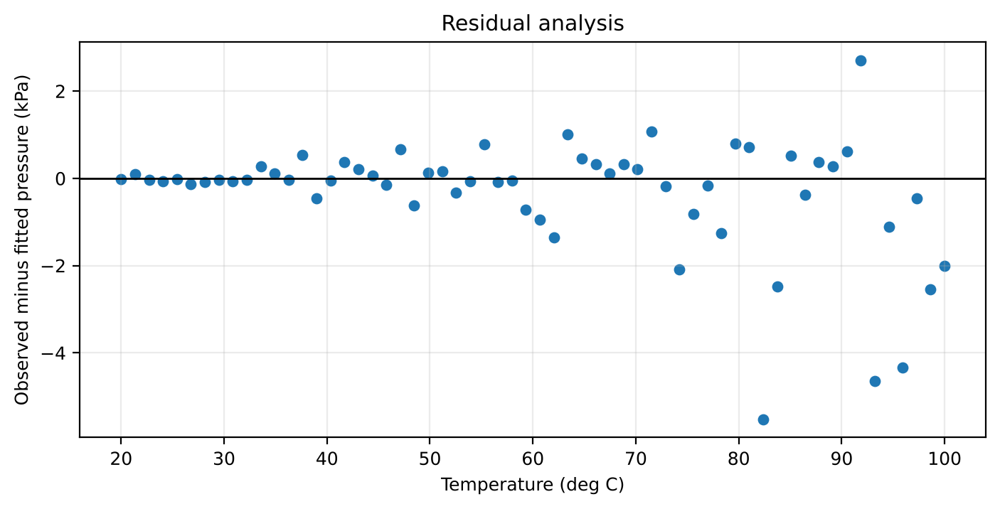
</p>

---

## Data testing

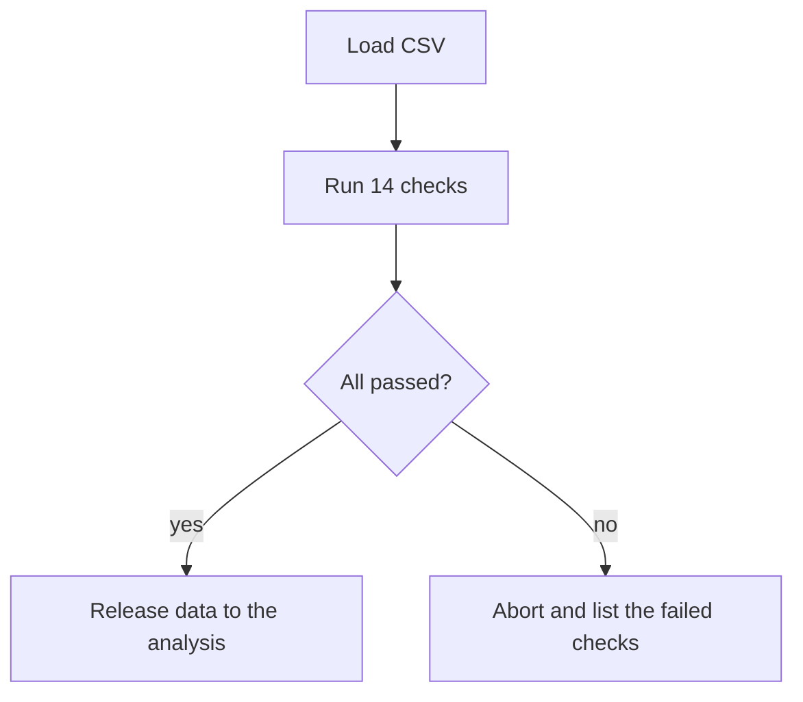

Both datasets are guarded by 14 automated checks each. The notebooks print `PASSED` / `FAILED` per check; the same checks live in `tests/` as `pytest` tests.

| Group | Stopping distance | Vapour pressure |
|---|---|---|
| Range and units | 20–120 km/h · equal steps · m/s = km/h ÷ 3.6 | 20–100 °C · equal steps · K = °C + 273.15 |
| Values | all positive · uncertainty = 5 % of simulated · $d$ rises with speed · grade factor 1.00 → 1.02 | all positive · uncertainty = 3 % of simulated · $P$ rises with $T$ · $\ln P$ vs $1/T$ straight ($r<-0.99$) |
| Noise | rms 2.5–8 % · no outlier beyond 25 % | rms 1.5–6 % · no outlier beyond 15 % |
| Physics | recovers $t_r=0.7$ s and $\mu=0.7$ | $P(100\,°\text{C})\approx101.325$ kPa · $L$ between 38 and 46 kJ/mol |
| Split | train/test labels only · 36/24 rows · train speeds precede test speeds | train/test labels only · 36/24 rows · train precedes test in $T$ |

The `tests/` folder also checks the ODE solvers and the fitted values:

| File | Tests | Covers |
|---|:-:|---|
| `test_stopping_distance_data.py` | 15 | the 14 stopping data checks plus completeness |
| `test_vapour_pressure_data.py` | 14 | the 14 vapour data checks |
| `test_ode_verification.py` | 11 | RK4 vs analytic, orders 1 and 4, energy and invariant conservation, limiting cases |
| `test_statistics.py` | 2 | $t_r$, $\mu$, $L$, $P_0$, $\chi^2$ and the $t$-test reproduce the reported values |

```bash
pytest            # 42 passed
```

---

## Supplementary analysis

Extra diagnostics computed by [`src/supplementary_analysis.py`](src/supplementary_analysis.py); every number below is in [`results/tables/supplementary_summary.csv`](results/tables/supplementary_summary.csv).

### Noise in the data

| | Stopping distance | Vapour pressure |
|---|--:|--:|
| rms relative noise | 5.87 % | 3.38 % |
| mean relative noise | +0.70 % | +0.47 % |

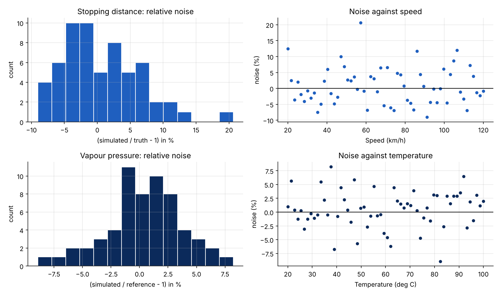

### Correlation between the fitted parameters

$t_r$ and $\mu$ are strongly correlated (correlation +0.89): a longer reaction time can be traded against a larger friction coefficient, so their joint uncertainty is an elongated region rather than the box formed by the two separate intervals. The generating point $(t_r,\mu)=(0.7,\,0.7)$ lies inside the 95 % joint region (Mahalanobis $\chi^2=3.42$, $p=0.18$ with 2 degrees of freedom).

<p align="center">
  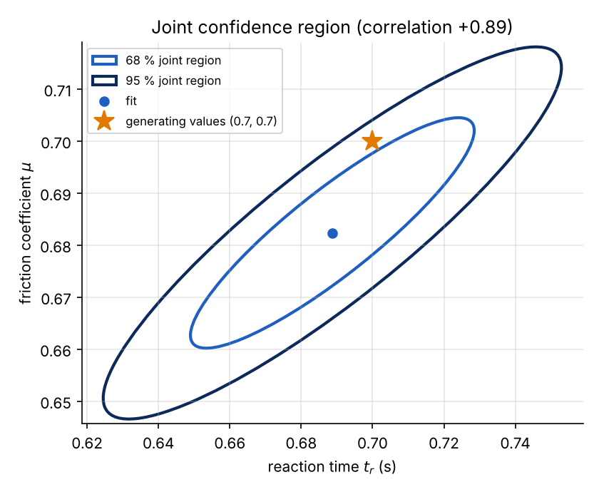
</p>

### Standardised residuals and normality

| | Stopping distance | Vapour pressure |
|---|--:|--:|
| Reduced $\chi^2$ | 1.28 | 1.37 (training rows) |
| rms standardised residual | n/a | 1.14 train, 1.16 test |
| Shapiro-Wilk $p$ of standardised residuals | 0.29 | 0.68 (training rows) |

Neither set of standardised residuals shows evidence against normality. Values above 1 mean the stated uncertainties are slightly too small for the actual scatter, as the reduced $\chi^2$ already indicated.

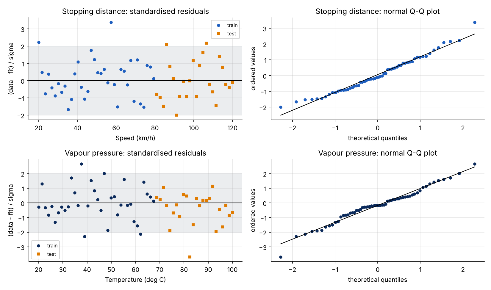

### Vapour pressure: fitted law and held-out data

The band shows the 95 % uncertainty of the fitted law propagated from the parameter covariance. Of the 24 held-out points, 23 (95.8 %) fall inside the 95 % prediction interval that combines the fit uncertainty with each point's stated uncertainty.

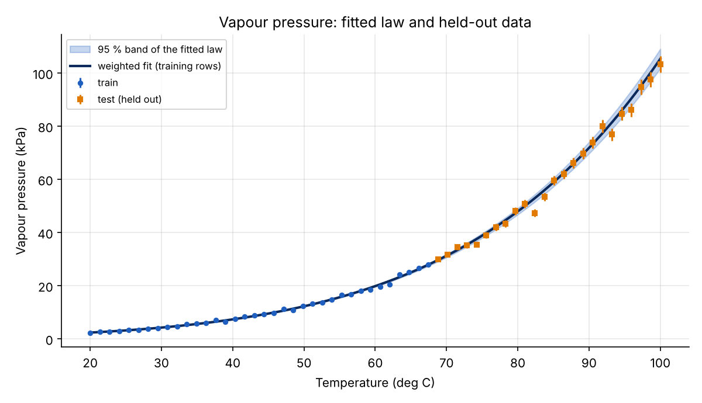

### Stopping distance: fit on the slow data only

As a counterpart to the vapour-pressure train/test evaluation, the stopping law is refitted on the slowest 60 % of speeds (36 rows) and evaluated on the fastest 40 % (24 rows). This is a supplementary check and not the Part 3 model comparison.

| | Train (slowest 60 %) | Test (fastest 40 %) |
|---|--:|--:|
| RMSE | 1.69 m | 4.38 m |
| rms relative error | 5.53 % | 5.65 % |

Refitted parameters: $t_r=0.682\pm0.036$ s, $\mu=0.675\pm0.026$ (all-data fit: $0.689\pm0.026$ s and $0.682\pm0.015$). The absolute error grows with speed because the distances are larger, while the relative error stays at about 5.6 %: the two-parameter law extrapolates to the fast speeds without loss of relative accuracy.

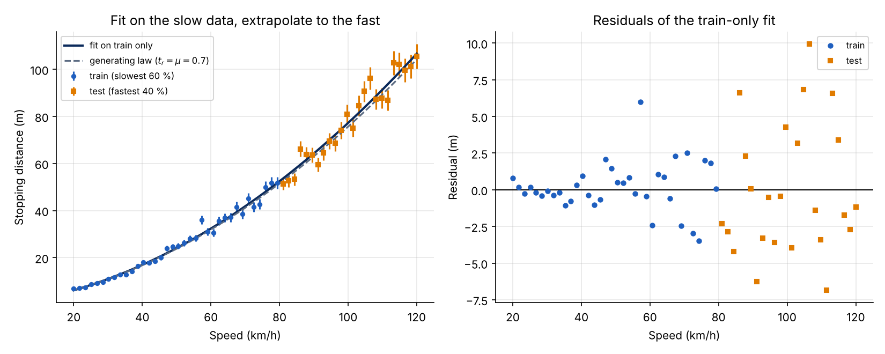

---

## Rubric map

| Line | What is required | Where it is shown |
|:-:|---|---|
| **B2** | ODE solutions match the analytic stopping distance and pressure law | [Part 1](#part-1-physics-model-simulate-and-verify), `tests/test_ode_verification.py` |
| **B3** | Energy check for braking; limiting cases within stated tolerances | energy panel, invariant and limit table |
| **B4** | Log-log convergence for both ODEs with measured orders | 1.00 / exact (braking), 0.97 / 3.96 (vapour) |
| **B5** | Fitted laws plotted against data with rms error | stopping rms 3.09 m; vapour rms tables and fit plots |
| **C4** | Reaction time consistent with 0.7 s, by interval and test | $t=-0.43$, $p=0.669$, interval [0.636, 0.741] |

---

## Scope and limitations

- **Part 3 (data-driven model)** of the problem statement is not part of this repository: no cross-validated comparison of $d=av$, $av^2$, $av+bv^2$, $av+bv^2+cv^3$, and no slow/fast extrapolation test (rubric line D6). The train/test labels in the CSVs (slowest 60 % / fastest 40 %) are in place for it.
- The stopping-distance fit uses all 60 points; the vapour-pressure fit uses the 36 training rows only.
- The vapour-pressure 95 % interval for $L$ uses a normal approximation.
- Data are synthetic, so recovered parameters describe the generator, not a real car or liquid.
- The notebooks are kept as submitted (Colab upload cells included); the scripts and tests are the portable, reproducible versions.

---

<div align="center">

**PH1050 · Foundation of Computational Physics · IIT Madras**

</div>
